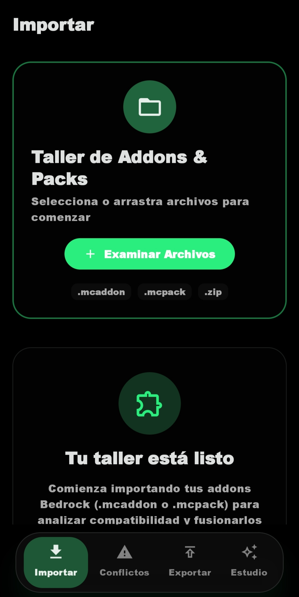
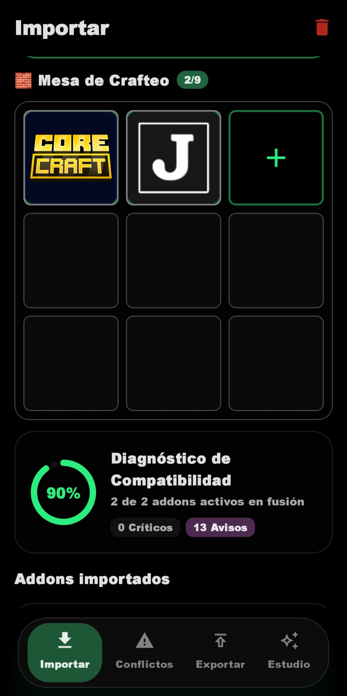
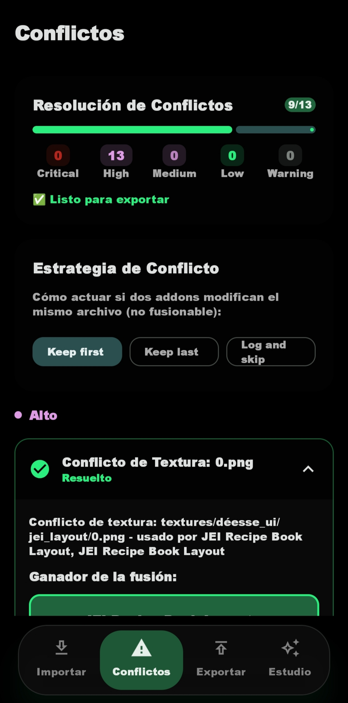
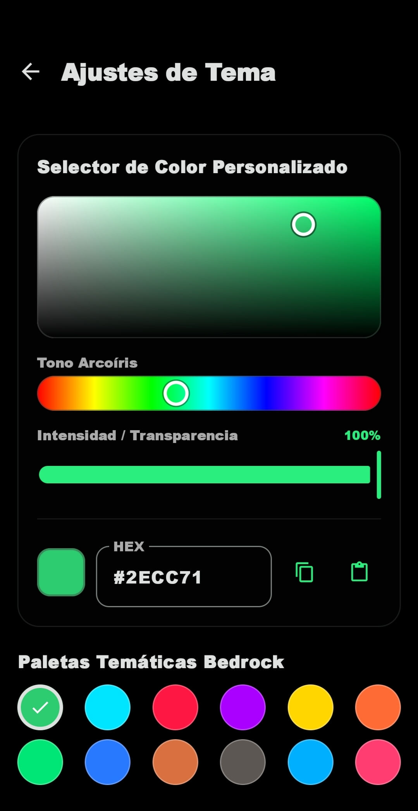
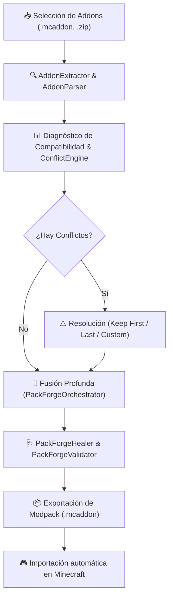

# ⚒️ PackForge

<div align="center">

> **Fusiona múltiples addons de Minecraft Bedrock Edition en un solo modpack funcional**  
> *Sin texturas rotas, sin conflictos manuales, sin dolores de cabeza.*

🌐 **Sitio Web Oficial:** [packforge.netlify.app](https://packforge.netlify.app/)

[](https://kotlinlang.org/)
[-3DDC84?style=for-the-badge&logo=android&logoColor=white)](https://www.android.com/)
[](https://developer.android.com/jetpack/compose)
[](https://github.com/Lord4rk2028/PackForge/actions)
[](LICENSE)

</div>

---

## 📖 Acerca de PackForge (About)

**PackForge** es una aplicación nativa para Android diseñada específicamente para la comunidad de **Minecraft Bedrock Edition**. Su objetivo principal es resolver uno de los problemas más comunes y frustrantes para jugadores y creadores: **la incompatibilidad y sobreescritura al intentar jugar con varios addons a la vez**.

Normalmente, combinar addons de forma manual implica abrir archivos comprimidos, descifrar y editar múltiples `manifest.json`, sincronizar UUIDs, fusionar archivos JSON complejos (`blocks.json`, `terrain_texture.json`, `item_texture.json`, `sound_definitions.json`) y renombrar identidades en conflicto para evitar crashes en el motor Bedrock.

**PackForge automatiza todo este proceso en segundos**, analizando las dependencias de Resource Packs (RP) y Behavior Packs (BP), resolviendo colisiones con estrategias configurables y generando un modpack limpio (`.mcaddon`) listo para importar directamente en el juego.

---

## 📱 Recorrido por la Aplicación (Screenshots dinámicos)

Explora las capacidades de PackForge paso a paso mediante su interfaz moderna en Material 3:

<table>
  <tr>
    <td width="50%" valign="top">
      <h3>1️⃣ Importación & Diagnóstico Inicial</h3>
      <p>Selecciona o arrastra múltiples archivos <code>.mcaddon</code>, <code>.mcpack</code> o <code>.zip</code>.</p>
      <ul>
        <li><b>Detección instantánea:</b> Desempaquetado seguro y parseo rápido de manifests.</li>
        <li><b>Soporte multiformato:</b> Compatible con addons empaquetados simples o combinados (RP + BP).</li>
        <li><b>Acceso a exploradores:</b> Integración con el selector de archivos del sistema Android.</li>
      </ul>
    </td>
    <td width="50%" align="center" valign="middle">
      
    </td>
  </tr>
  <tr>
    <td width="50%" align="center" valign="middle">
      
    </td>
    <td width="50%" valign="top">
      <h3>2️⃣ Mesa de Crafteo & Compatibilidad</h3>
      <p>Supervisa todos los addons cargados y evalúa su viabilidad de fusión.</p>
      <ul>
        <li><b>Mesa de Crafteo 3x3:</b> Cuadrícula interactiva para organizar y gestionar tus addons activos.</li>
        <li><b>Diagnóstico predictivo de compatibilidad:</b> Indicador dinámico (p. ej. 90% compatibilidad) que evalúa versiones de Bedrock, schemas y dependencias.</li>
        <li><b>Conteo de salud:</b> Diferenciación visual entre alertas críticas y avisos leves que no impiden jugar.</li>
      </ul>
    </td>
  </tr>
  <tr>
    <td width="50%" valign="top">
      <h3>3️⃣ Centro de Resolución de Conflictos</h3>
      <p>Controla al milímetro cómo interactúan los addons duplicados o superpuestos.</p>
      <ul>
        <li><b>Métricas por severidad:</b> Clasificación detallada en <i>Critical</i>, <i>High</i>, <i>Medium</i>, <i>Low</i> y <i>Warning</i>.</li>
        <li><b>Estrategias de resolución rápida:</b>
          <ul>
            <li><code>Keep first</code>: Da prioridad al addon cargado primero.</li>
            <li><code>Keep last</code>: Sobrescribe con el último addon añadido.</li>
            <li><code>Log and skip</code>: Omite colisiones manteniendo registro de auditoría.</li>
          </ul>
        </li>
        <li><b>Conflictos específicos:</b> Visor expandible de texturas, sonidos, animaciones y entidades en conflicto con indicación del ganador.</li>
      </ul>
    </td>
    <td width="50%" align="center" valign="middle">
      
    </td>
  </tr>
  <tr>
    <td width="50%" align="center" valign="middle">
      
    </td>
    <td width="50%" valign="top">
      <h3>4️⃣ Studio & Ajustes de Personalización</h3>
      <p>Adapta PackForge a tu estilo y gestiona tus recursos con comodidad.</p>
      <ul>
        <li><b>Selector de color dinámico:</b> Elige cualquier color mediante espectro visual, barra de tono y código HEX con soporte de portapapeles.</li>
        <li><b>Paletas temáticas Bedrock:</b> Variedad de estilos predefinidos inspirados en el universo Minecraft.</li>
        <li><b>Modo Oscuro / Claro fluido:</b> Animaciones optimizadas en Jetpack Compose con transiciones suaves.</li>
      </ul>
    </td>
  </tr>
</table>

---

## ⚡ ¿Qué hace único a PackForge?

| Característica | Fusión Manual / Otros Zips | ⚒️ PackForge |
|---|---|---|
| **Manejo de Manifests** | Propenso a errores de UUID y sintaxis | Generación y sincronización de UUIDs v4 automática |
| **Archivos JSON Críticos** | Sobrescritura destructiva | Fusión profunda inteligente (`JsonDeepMerger`) |
| **Colisiones de Texturas** | Una textura elimina la otra | Detección granular y resolución con selección de ganador |
| **Diagnóstico de Salud** | Pruebas a ciegas en el juego | `PackForgeHealer` + `PackForgeValidator` previos al juego |
| **Exportación** | Compresión manual .zip y renombramiento | Exportación optimizada en un solo `.mcaddon` ejecutable |

---

## 🚀 Motor de Fusión Bedrock (`domain/engine`)

El núcleo técnico de PackForge implementa una serie de componentes de ingeniería especializados para Minecraft Bedrock:

- **`PackForgeOrchestrator`**: Administra el pipeline completo: descompresión, indexado, análisis de compatibilidad, fusión de subcomponentes y empaquetado final.
- **`JsonDeepMerger` & `LenientJson`**: Fusión no destructiva de árboles JSON complejos, tolerando discrepancias comunes de sintaxis presentes en addons comunitarios.
- **`ConflictEngine` & `ConflictRegistry`**: Detección anticipada de choques de identificadores, colisiones de recetas, loot tables, animaciones y scripts.
- **`PackForgeHealer`**: Módulo de autodiagnóstico post-merge que detecta referencias rotas y sugiere coincidencias difusas (*fuzzy matching*) sin corromper el contenido original.
- **`PackForgeValidator`**: Validador estricto que asegura que el modpack final cumpla los estándares exigidos por el motor de Bedrock antes de permitir su exportación.
- **`BedrockCriticalFilesMerger`**: Algoritmos dedicados para fusionar armónicamente:
  - `blocks.json` y `terrain_texture.json`
  - `item_texture.json`
  - `sound_definitions.json` y `sounds.json`
  - Definiciones de entidades y attachables en Resource & Behavior Packs

---

## 🧪 Flujo de Trabajo



---

## 📲 Instalación y Descargas

### 🔹 Opción 1: Descargar APK compilado (Recomendado)
Puedes obtener el archivo `.apk` de prueba generado automáticamente por nuestro pipeline de integración continua:
1. Dirígete a la pestaña de [**GitHub Actions (Android CI)**](https://github.com/Lord4rk2028/PackForge/actions).
2. Haz clic en la ejecución más reciente en la rama `master`.
3. En la sección **Artifacts**, descarga el archivo **`debug-apk`**.

### 🔹 Opción 2: Compilar desde el código fuente

```bash
# 1. Clonar el repositorio
git clone https://github.com/Lord4rk2028/PackForge.git
cd PackForge

# 2. Dar permisos de ejecución a Gradle wrapper (Linux/macOS)
chmod +x gradlew

# 3. Compilar APK Debug
./gradlew assembleDebug

# El APK se genera en:
# app/build/outputs/apk/debug/app-debug.apk
```

Para correr las suites de pruebas unitarias locales:
```bash
./gradlew test
```

---

## 🛠️ Especificaciones Técnicas

- **Plataforma objetivo:** Android 8.0+ (API 26 mínima, API 35 destino)
- **Lenguaje:** Kotlin 2.3.21
- **UI Toolkit:** Jetpack Compose con Compose BOM 2025 + Material 3 Expressive (1.4.0)
- **Patrón de Arquitectura:** Clean Architecture + MVVM (StateFlow, Coroutines)
- **Base de Datos Local:** Room Database 2.8.4 con KSP
- **Almacenamiento Clave-Valor:** DataStore Preferences 1.1.1
- **Carga Asíncrona de Imágenes:** Coil Compose 2.6.0
- **Networking:** Retrofit 2.11 + OkHttp 4.12 + Gson
- **Compilador / Build Tool:** Gradle 9.7.1 + Android Gradle Plugin 9.3.1

---

## 📄 Licencia (License)

Este proyecto se distribuye bajo la licencia **MIT**. Puedes consultar el texto completo en el archivo [`LICENSE`](LICENSE).

```text
MIT License
Copyright (c) 2026 Lord4rk2028 (PackForge)

Permission is hereby granted, free of charge, to any person obtaining a copy
of this software and associated documentation files (the "Software"), to deal
in the Software without restriction, including without limitation the rights
to use, copy, modify, merge, publish, distribute, sublicense, and/or sell
copies of the Software...
```

---

## ⚠️ Aviso Legal & Descargo de Responsabilidad

- **Minecraft** es una marca comercial registrada de **Mojang Synergies AB / Microsoft Corporation**.
- **PackForge** es un desarrollo independiente que **no** está afiliado, respaldado, autorizado ni vinculado formalmente a Mojang ni a Microsoft.
- PackForge **no distribuye ni comercializa recursos creativos de terceros**: actúa exclusivamente como herramienta técnica en el dispositivo del usuario para fusionar archivos que este provee legítimamente.

---

<div align="center">
  <sub>Desarrollado con dedicación para los creadores y jugadores de Minecraft Bedrock.</sub><br/>
  <sub>¿Encontraste un problema o tienes sugerencias? ¡Abre una <a href="https://github.com/Lord4rk2028/PackForge/issues">Issue</a> o envía un Pull Request!</sub>
</div>
